# Realistic Carplate Generation

在 Linux x86_64 开发机上批量替换照片中的中国车牌，或生成正面车牌图片。使用 CPU，输出图片和 UTF-8 号码标签。

## 安装

需要 Python 3.12。系统需提供 venv 和 OpenCV 运行库；Debian/Ubuntu 常用运行库为 `libgl1`、`libglib2.0-0`。

在仓库根目录执行：

```bash
python3.12 -m venv .venv
source .venv/bin/activate
python -m pip install -e '.[detection]'
```

## 替换照片中的车牌

1. 准备汉字字体、字母数字字体。原有效果预览使用的是以下两套字体：

| 用途 | 实际使用的字体原文件名 | 重命名后放置的位置 |
|---|---|---|
| 汉字：专用车牌字体 | `车牌字体.ttf` | `assets/fonts/plate_han.ttf` |
| 字母数字：CN License A（GA36） | `CNLicense-A_GA36.ttf` | `assets/fonts/plate_latin.ttf` |

在 `fonts.han`、`fonts.latin` 中填写对应路径。字体不随仓库提供；汉字字体需覆盖 31 个省份简称，拉丁字体需覆盖大写字母和数字。仅测试流程时可使用 [Noto CJK](https://github.com/notofonts/noto-cjk/tree/main/Sans/OTF/SimplifiedChinese)。

1. 将自己的 JPG、JPEG 或 PNG 车辆照片放进 `input/`，子目录也会读取。首次建议用几张车牌清晰的照片。

2. 复制配置后修改 `config.local.json`。

```bash
cp config.json config.local.json
```

默认配置如下，通常只需修改 `input`、`output`、`count`、`plate_type` 和 `fonts`：

下例的 `//` 为阅读注释，实际 JSON 配置文件中不要保留这些注释。

```jsonc
{
  "mode": "replace",                         // replace：替换照片车牌；render：只生成正面车牌
  "input": "input",                          // 原图目录，例如 "data/photos"；也可指定四角标注 JSONL
  "output": "outputs/replaced",              // 新任务输出目录，例如 "outputs/run_001"
  "count": 100,                              // 输出整图数量，例如 1000；合格底图不足时会复用
  "plate_type": "blue",                      // blue / nev_small / nev_large / all，按下表选择
  "fonts": {                                // 分别设置汉字字体和字母数字字体
    "han": "assets/fonts/plate_han.ttf",      // 例如 "assets/fonts/车牌字体.ttf"
    "latin": "assets/fonts/plate_latin.ttf"   // 例如 "assets/fonts/CNLicense-A_GA36.ttf"
  },
  "format": "png",                           // png：无损保存；jpg：JPEG 保存，会重编码整图
  "seed": 42,                                // 固定随机种子，例如 20261023；相同配置可复现
  "workers": 2,                              // 替换进程数，1–12；例如 4，内存有限时用 1
  "resume": false,                           // 新任务用 false；中断后保持原配置，改为 true 继续
  "render_mode": "material",                 // material：保留原牌材质；full：重绘整个牌面
  "augment": true,                           // true：随机增强牌面；仅替换号码时可设 false
  "export_crops": true                       // true：额外导出 OCR 裁剪；只需整图时设 false
}
```

4. 运行：

```bash
python run.py
```

程序优先读取 `config.local.json`，不存在时读取 `config.json`，自动完成检测、号码分配、透视替换和校验。`count` 是输出整图数，底图不足时会复用合格照片；默认每张图替换一块车牌。

| 原照片中的车牌 | `plate_type` |
|---|---|
| 蓝牌 | `blue` |
| 绿牌，生成小型新能源 | `nev_small` |
| 绿牌，生成大型新能源黄绿牌 | `nev_large` |
| 同时有蓝牌、绿牌照片，按 40% / 45% / 15% 混合生成 | `all` |

路径可写绝对路径或相对于配置文件的路径。每次新任务使用空的 `output` 目录；替换任务中断后，保持其他配置不变，只将 `resume` 改为 `true` 继续。

## 只生成正面车牌

在同一份本地配置中改为 `"mode": "render"`、`"output": "outputs/plates"`、`"resume": false`，再运行 `python run.py`。此模式只需字体，不需要照片。蓝牌输出 880 × 280，新能源输出 960 × 280。

也可指定其他配置：`python run.py --config 配置文件.json`。

## 输出和常用选项

```text
outputs/replaced/
  images/000001.png
  labels.jsonl
  crops/images/000001.png
  crops/labels.jsonl
  summary.json
```

默认单牌替换的标签示例：

```json
{"image":"images/000001.png","text":"苏E12345","plate_type":"blue","quad":[[240,80],[40,80],[40,30],[240,30]],"background":"/absolute/path/photo.jpg"}
```

`quad` 按右下、左下、左上、右上排列；标签不含分隔点。`crops/` 为矫正后的 OCR 训练图，蓝牌 440 × 140，新能源 480 × 140。

- `render_mode: "material"` 清除旧字、绘制新号码，保留原牌材质；`"full"` 重绘整个牌面并匹配光照。
- `augment: true` 每牌随机选择 0–3 项增强，仅作用于牌面；不需要增强时改为 `false`。
- `format: "png"` 保证保存后牌面外像素不变；`"jpg"` 会重编码整图。
- `export_crops: false` 关闭 OCR 裁剪；`workers` 控制替换进程数，范围为 1–12。

没有检测到合格车牌时，换用更清晰的照片；默认要求原牌高度至少 32 像素。已有四角时，将 `input` 指向 JSONL 标注文件，每行一张照片：

```json
{"background":"/absolute/path/photo.jpg","quad":[[240,80],[40,80],[40,30],[240,30]],"colour":"blue"}
```

其中 `colour` 为 `blue` 或 `green`。CCPD 原始文件名中的四角会自动读取。

## 号码规则

| 牌型 | 格式 | 外观 |
|---|---|---|
| `blue` | 省份 + 字母 + 5 位字母或数字，末 5 位中字母最多 2 个 | 蓝底白字 |
| `nev_small` | 省份 + 字母 + `ABCDEFGHJK` 中一位 + 字母或数字 + 4 位数字 | 白绿渐变底黑字 |
| `nev_large` | 省份 + 字母 + 5 位数字 + `D` 或 `F` | 黄绿双拼底黑字 |

省份使用 31 个大陆省级简称；机关字母和普通字母位不含 `I`、`O`。省份、机关字母、小型新能源第 3 位分别均衡抽样，同一批次号码不重复。`all` 按 40% / 45% / 15% 分配，不足整数时按最大余数法取整。程序校验号码格式，不查询省市实际发牌关系。

## 效果预览

### 真实车辆场景：原图与合成图

**左侧为原始车辆照片，右侧为合成照片。** 上方为整图，下方为透视矫正后的车牌。

**蓝牌场景**

| 样例 1 | 样例 2 | 样例 3 |
|:---:|:---:|:---:|
| [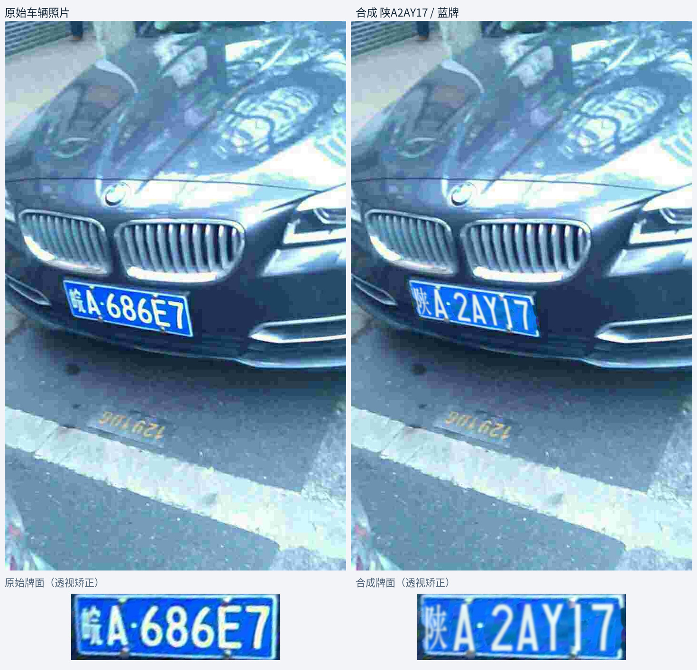](assets/readme/scene_comparison_blue_01.jpg) | [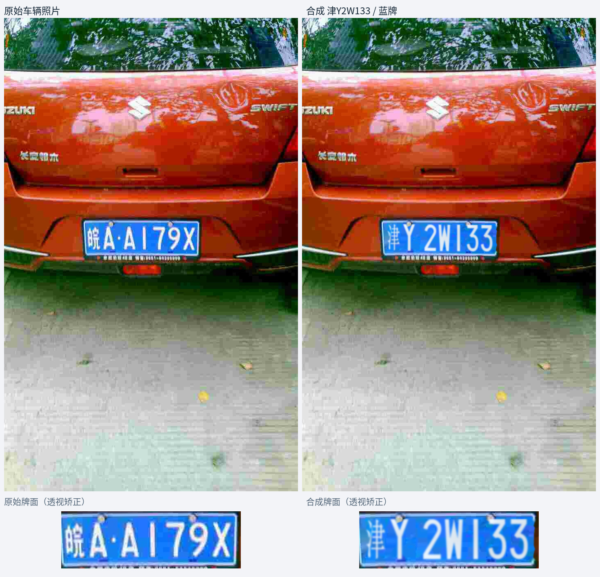](assets/readme/scene_comparison_blue_02.jpg) | [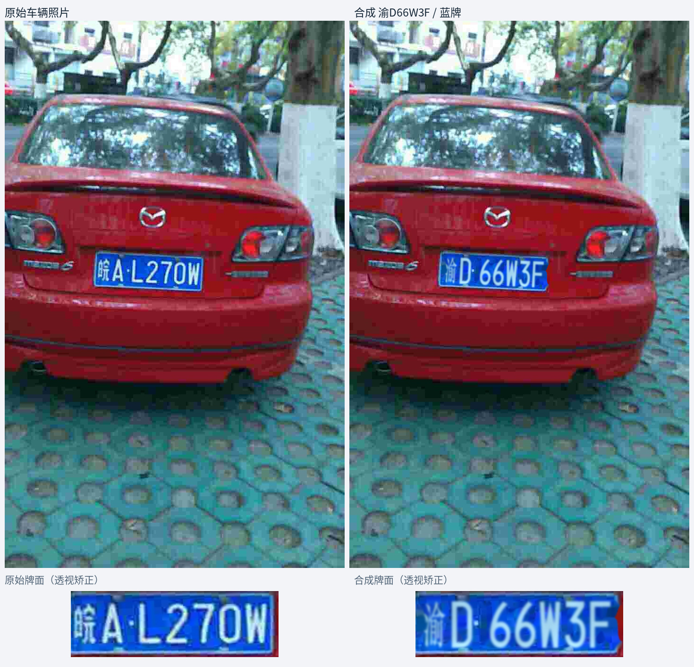](assets/readme/scene_comparison_blue_03.jpg) |

**小型新能源场景**

| 样例 1 | 样例 2 | 样例 3 |
|:---:|:---:|:---:|
| [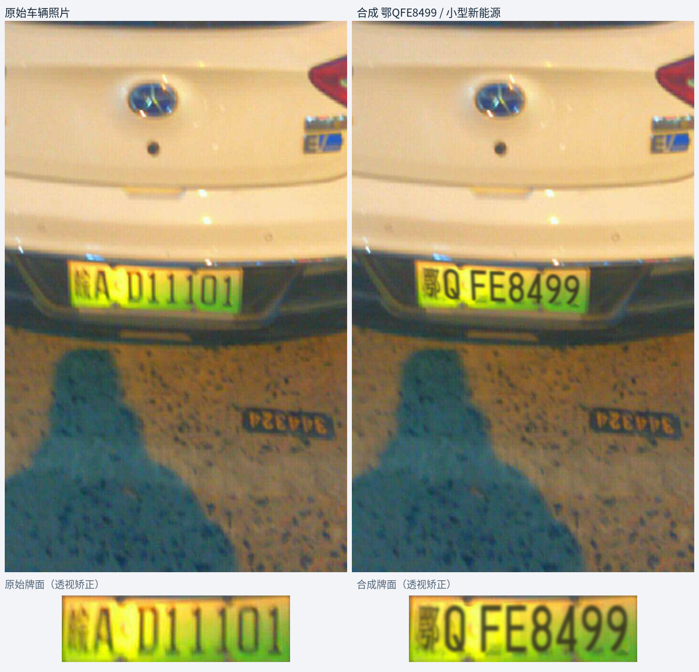](assets/readme/scene_comparison_nev_small_01.jpg) | [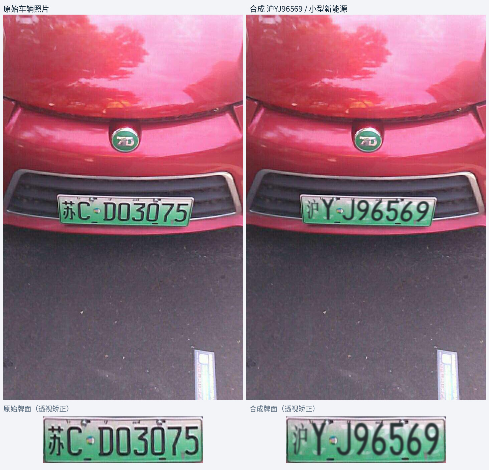](assets/readme/scene_comparison_nev_small_02.jpg) | [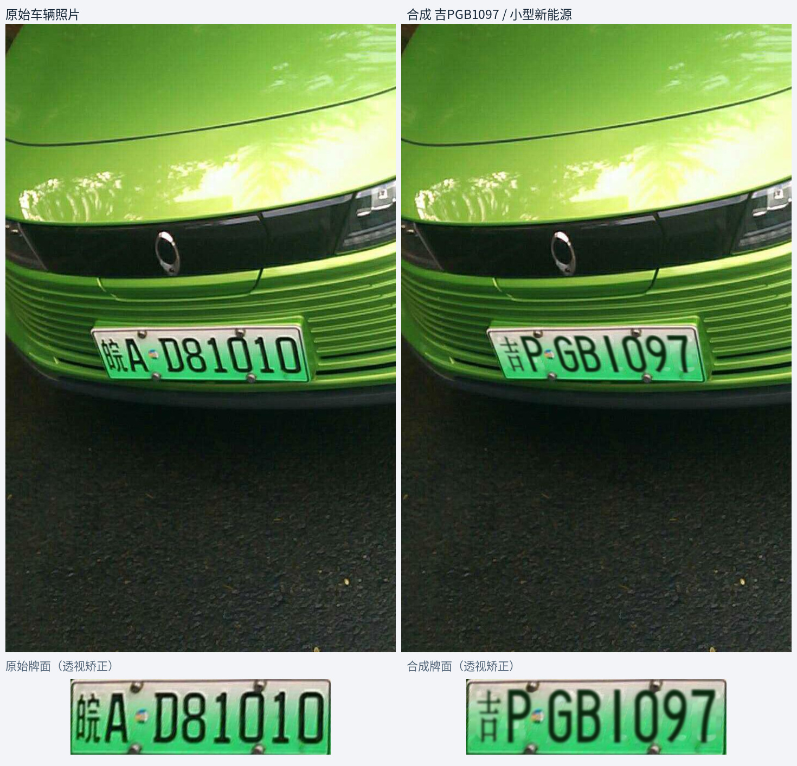](assets/readme/scene_comparison_nev_small_03.jpg) |

**大型新能源牌型（黄绿模板）**

| 样例 1 | 样例 2 | 样例 3 |
|:---:|:---:|:---:|
| [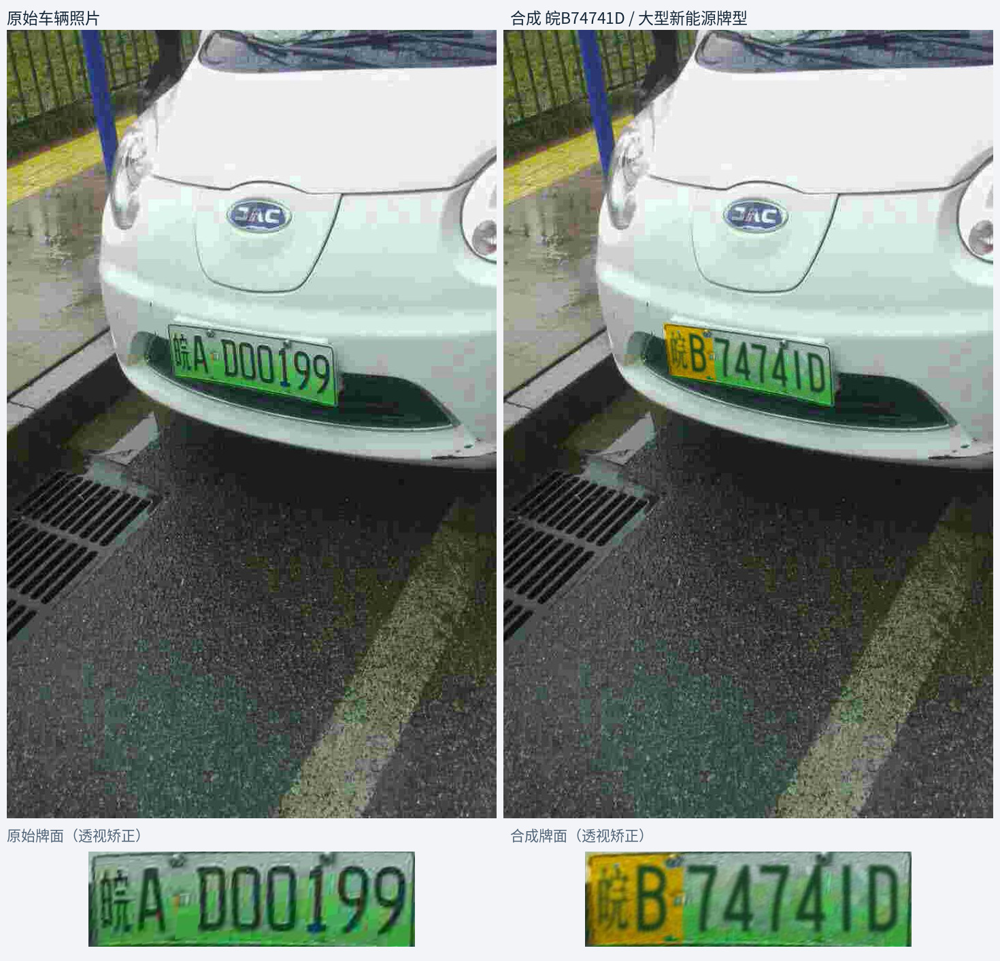](assets/readme/scene_comparison_nev_large_01.jpg) | [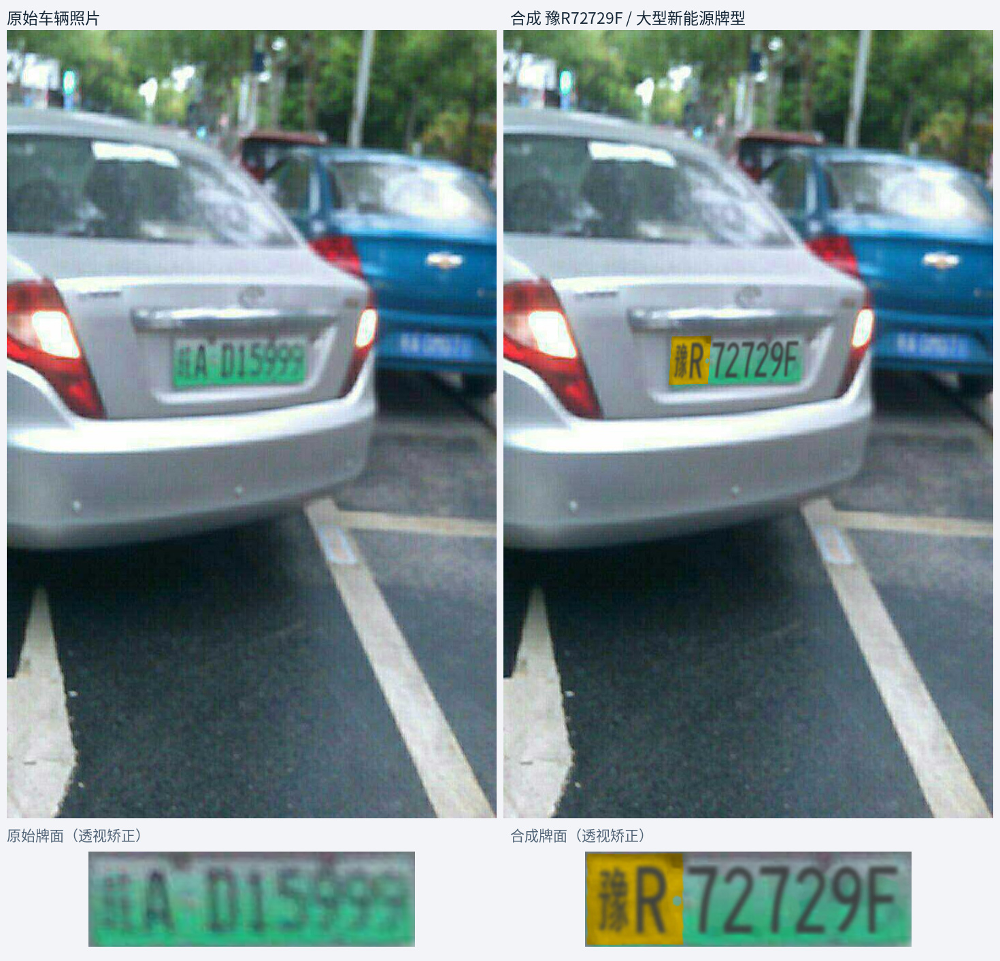](assets/readme/scene_comparison_nev_large_02.jpg) | [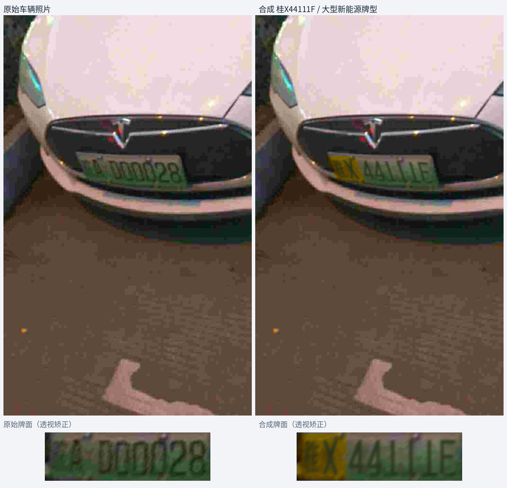](assets/readme/scene_comparison_nev_large_03.jpg) |

### 车牌局部：原图与合成图

**左侧为原始车牌，右侧为替换号码后的合成结果。** 上三组来自 CCPD，下三组来自 ODL，涵盖蓝牌、小型新能源和大型新能源。

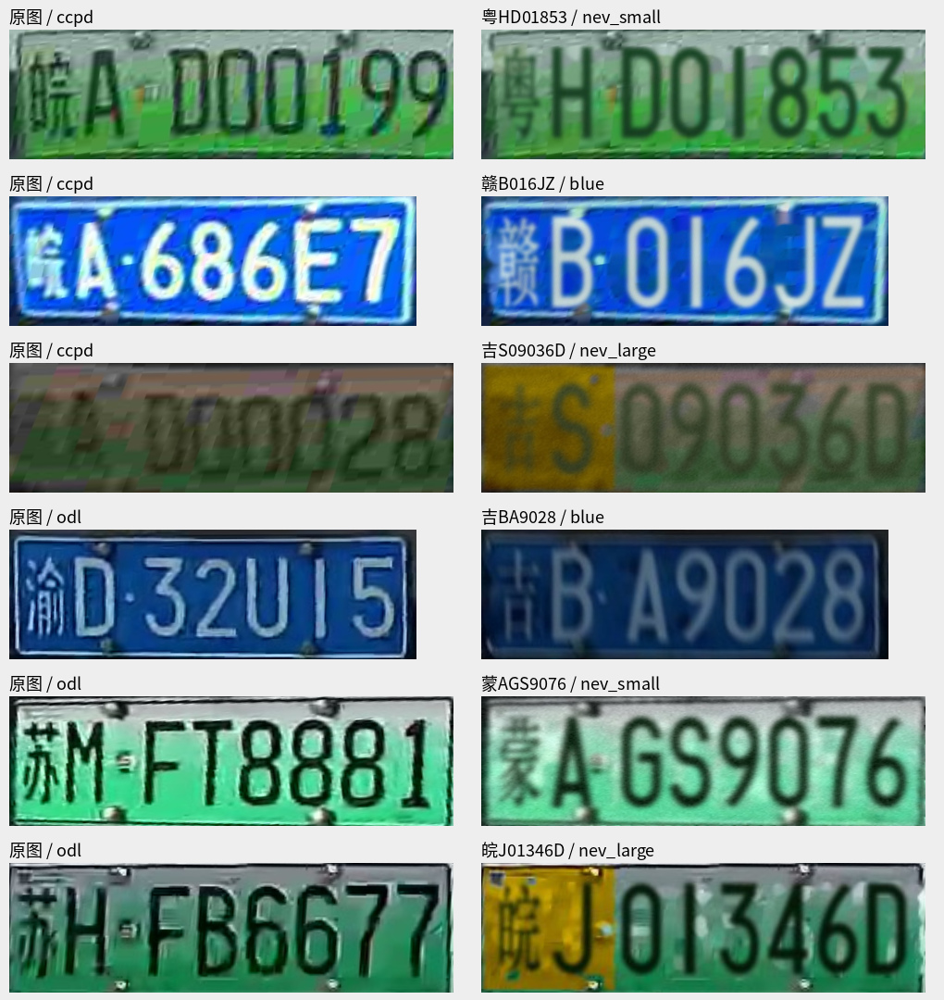

### 多省份合成样例

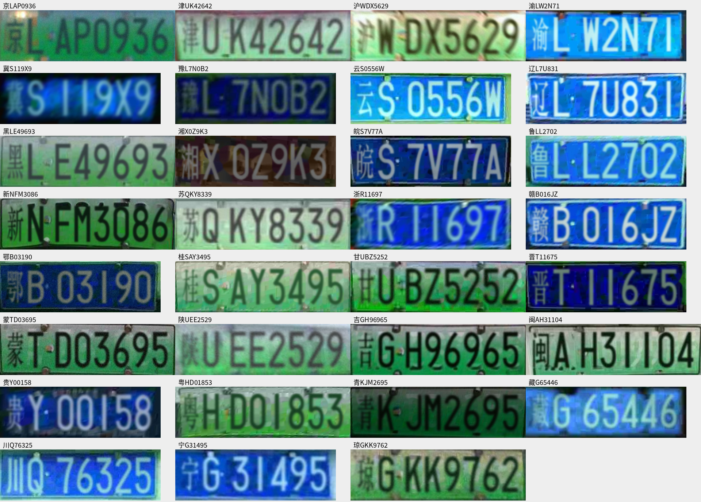

## 模型与许可

检测模型已随仓库提供，默认使用 HyperLPR；YOLO 和 E3 为可选模型。

| 模型 | 来源与许可 |
|---|---|
| HyperLPR 检测、OCR | [固定上游版本](https://github.com/szad670401/HyperLPR/tree/58ad4ef736fec5289e8c8cb842e066e70c4672c3)，[Apache-2.0](assets/models/hyperlpr3/LICENSE.HyperLPR.txt)|
| YOLO26n 检测 | [Ultralytics 8.4.138](https://github.com/ultralytics/ultralytics/tree/v8.4.138)，[AGPL-3.0](assets/models/yolo/LICENSE.AGPL-3.0.txt)|
| E3 双头 OCR | 本项目训练权重，[Apache-2.0](assets/models/e3/LICENSE.Apache-2.0.txt) |

自有源码采用 [Apache-2.0](LICENSE)，第三方归属见 [NOTICE](NOTICE)。使用和再分发模型需遵循各自许可，YOLO 的 AGPL 对应源码要求仍然适用。

公开文件检查：`python tools/check_public.py`。
